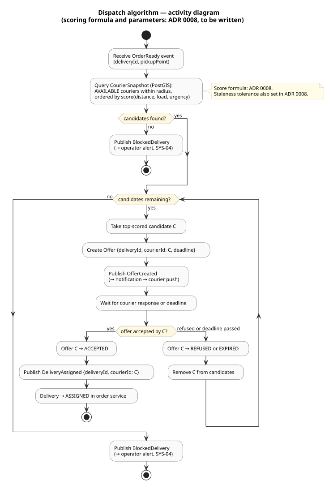

# Dispatch algorithm — activity diagram

Activity diagram for the dispatch algorithm: how a courier is selected for a delivery, from the
`OrderReady` event to `DeliveryAssigned` (or a blocked-delivery alert).

**Status:** validated by the owner on 2026-11-03.

The scoring formula, the initial search radius, and the offer deadline are **not fixed here**.
They are the subject of ADR 0008 (dispatch algorithm), which has not yet been written.

 — source:
[activity-dispatch.puml](activity-dispatch.puml)

---

## Steps

1. **Receive `OrderReady`** — includes the delivery id and the pickup point.
2. **Query `CourierSnapshot`** — PostGIS proximity query for `AVAILABLE` couriers within the
   initial radius, ordered by score (distance, load, urgency). The `CourierSnapshot` table is
   local to the `dispatch` service and eventually consistent (ADR 0003).
3. **No candidates** → publish `BlockedDelivery` alert for the operator (SYS-04). Stop.
4. **For each candidate in score order:**
   - Create an `Offer` with a deadline and publish `OfferCreated` (triggers a push notification
     to the courier via the `notification` service).
   - Wait for the courier's answer or the deadline.
   - **Accepted** → `Offer` → `ACCEPTED`; publish `DeliveryAssigned`; `Delivery` → `ASSIGNED`.
     Stop.
   - **Refused or expired** → `Offer` → `REFUSED` / `EXPIRED`; remove the candidate; try the
     next one.
5. **All candidates exhausted** → publish `BlockedDelivery` alert for the operator (SYS-04). Stop.

---

## Open points (ADR 0008)

| Point | Status |
|---|---|
| Scoring formula (weights for distance, load, urgency) | ADR 0008 |
| Initial search radius and expansion strategy | ADR 0008 |
| Offer deadline value | ADR 0008 |
| Maximum load per courier (cap on `activeDeliveries`) | ADR 0008 |
| Staleness tolerance for `CourierSnapshot` positions | ADR 0008 |
| Fallback when all candidates refuse (V2: reassignment by operator) | V2 |
