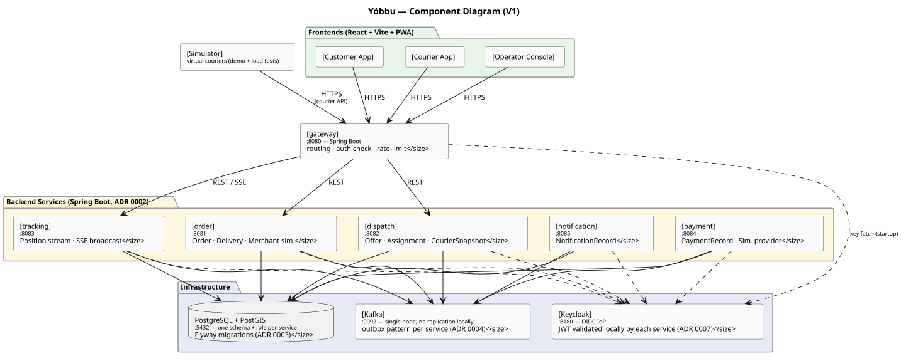
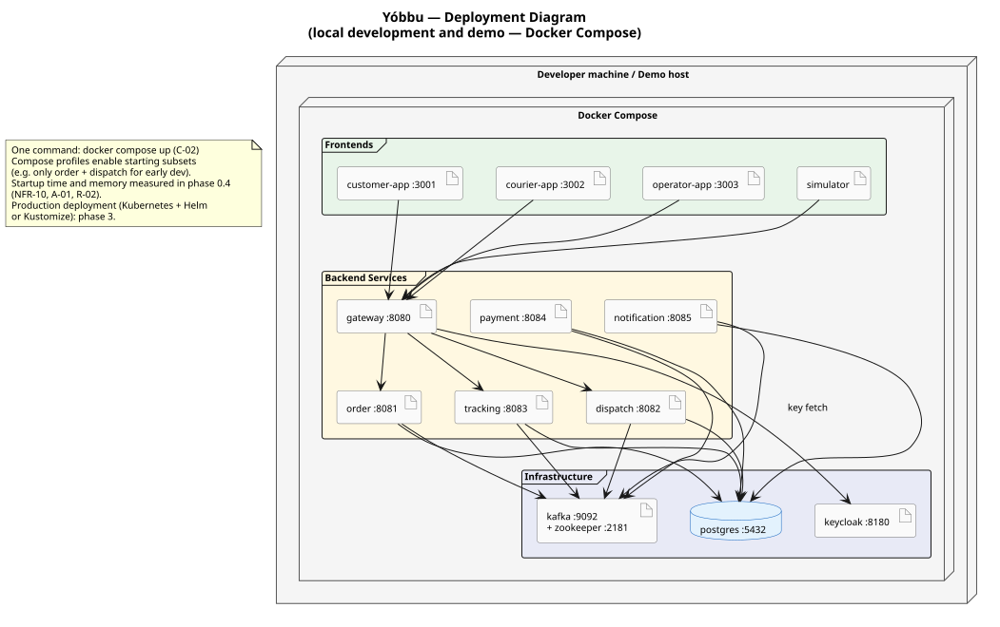

# Architecture diagrams

Component view (what the system is made of and how the parts connect) and deployment view
(how it runs locally with Docker Compose).

**Status:** validated by the owner on 2026-11-03.

Sources: [domain breakdown](domain-breakdown.md), [ADR 0001](../adr/0001-microservices.md),
[ADR 0002](../adr/0002-backend-java-spring-boot.md), [ADR 0003](../adr/0003-postgresql-postgis.md),
[ADR 0004](../adr/0004-messaging-kafka.md), [ADR 0006](../adr/0006-frontend-react.md),
[ADR 0007](../adr/0007-authentication-keycloak.md).

---

## Component diagram

 — source:
[component-diagram.puml](component-diagram.puml)

All six backend services are Spring Boot applications (ADR 0002). Each owns a separate PostgreSQL
schema and role (ADR 0003). All services publish and subscribe to Kafka topics (ADR 0004). All
services validate JWTs locally using Keycloak's public key fetched at startup (ADR 0007); no
per-request call to Keycloak.

The `gateway` is the single entry point for all clients. It handles routing, auth check (token
signature and expiry), and rate limiting. `tracking` also serves SSE connections routed through
the gateway.

The simulator is not a production component; it uses the same courier app APIs as a real courier
and is used only for demos and load tests.

---

## Deployment diagram (local dev and demo)

 — source:
[deployment-diagram.puml](deployment-diagram.puml)

Everything runs in Docker Compose with a single command: `docker compose up` (C-02). Ports are
exposed to the host for local development.

| Component | Port | Notes |
|---|---|---|
| customer-app | 3001 | React Vite dev server or static build |
| courier-app | 3002 | React Vite dev server or static build |
| operator-app | 3003 | React Vite dev server or static build |
| gateway | 8080 | Single external entry point for all API calls |
| order | 8081 | Internal only (reached through gateway) |
| dispatch | 8082 | Internal only |
| tracking | 8083 | Internal only (also serves SSE through gateway) |
| payment | 8084 | Internal only |
| notification | 8085 | Internal only |
| postgres | 5432 | One instance, six schemas |
| kafka | 9092 | Single node, no replication in local mode |
| keycloak | 8180 | OIDC identity provider |

**Compose profiles** (to be defined in phase 0.4) will allow starting subsets of services for
faster iteration during early development (for example `order` + `dispatch` only, with a
minimal infra profile).

**Startup and memory** are measured when the skeleton exists (phase 0.4, NFR-10, A-01, R-02).

**Production deployment** (Kubernetes with Helm or Kustomize, GitOps, rolling deployments) is
phase 3. One database instance per service is possible in production while keeping the same
schema and migration strategy.

---

## Decisions

Confirmed by the owner on 2026-11-03.

1. **Ports are illustrative.** The exact values are set in `docker-compose.yml` when the skeleton
   is written (phase 0.4). The numbering scheme above (808x for backend, 300x for frontends) is
   a convention, not a fixed constraint.
2. **Zookeeper is shown alongside Kafka.** A Zookeeper-free Kafka (KRaft mode) is possible but
   not decided; this is a configuration detail for phase 0.4.
3. **The production deployment is not modelled here.** It is the subject of a deployment ADR
   in phase 3. The local diagram shows the design intent; the production diagram follows once
   the infrastructure decisions are made.
