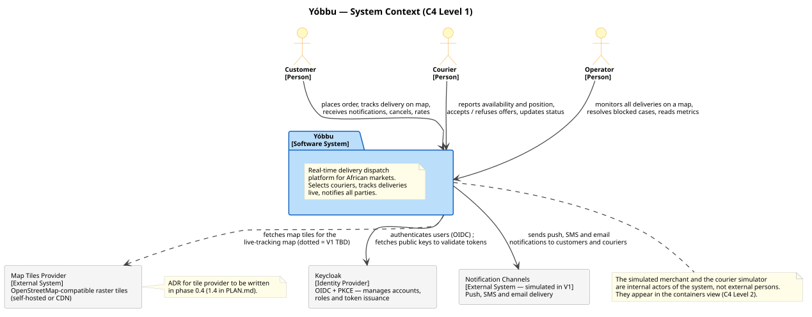
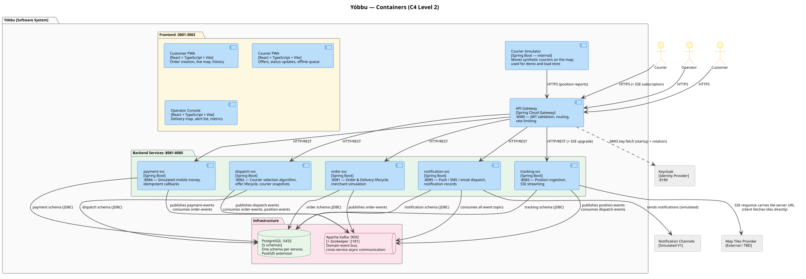
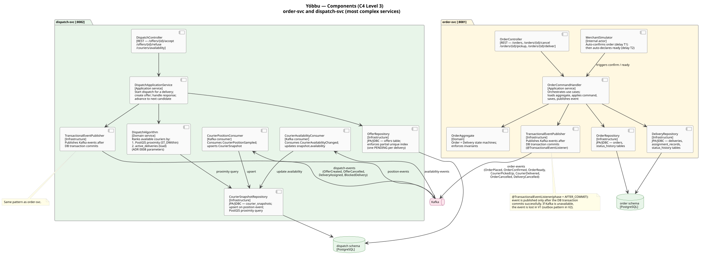

# C4 model

Three-level C4 model for Yóbbu V1: system context, containers, and components of the two
most complex services (order and dispatch).

**Status:** validated by the owner on 2026-11-03.

Sources: [domain breakdown](domain-breakdown.md), [data model](data-model.md),
[architecture diagrams](architecture-diagrams.md),
[ADR 0001](../adr/0001-architecture-microservices.md),
[ADR 0002](../adr/0002-architecture-backend-java-spring.md).

---

## Level 1 — System Context

 — source: [c4-context.puml](c4-context.puml)

Yóbbu interacts with three groups of people and three external systems.

**People**

| Person | Description |
|--------|-------------|
| Customer | Sends orders and tracks deliveries in real time via the Customer PWA |
| Courier | Receives and acts on delivery offers; reports their position via the Courier PWA |
| Operator | Monitors all deliveries on a map and resolves blocked cases via the Operator Console |

The simulated merchant is not a person: it is an internal component of the order service
that automatically confirms orders and declares them ready (configurable delays). It
appears at Level 2 as a component within `order-svc`.

**External systems**

| System | Role |
|--------|------|
| Keycloak | OIDC identity provider; issues and signs JWTs; each service validates tokens locally against the JWKS endpoint |
| Notification Channels | Push / SMS / email delivery; simulated in V1 (a stub that logs notifications without sending) |
| Map Tiles Provider | Raster tiles for the live-tracking map; the tile-server URL is returned by `tracking-svc` in SSE metadata and fetched by the browser directly — Yóbbu does not proxy tiles. The provider decision is deferred to phase 1.4 (ADR not yet written) |

---

## Level 2 — Containers

 — source: [c4-containers.puml](c4-containers.puml)

### Frontend containers (React + TypeScript + Vite)

| Container | Port | Audience | Key capabilities |
|-----------|------|----------|-----------------|
| Customer PWA | 3001 | Customers | Order form, live map with ETA, notification history, cancel button |
| Courier PWA | 3002 | Couriers | Availability toggle, offer card with countdown, status update buttons, offline position queue |
| Operator Console | 3003 | Operators | Full delivery map, alert list, delivery table, basic metrics |

All three are PWAs (Progressive Web Apps): installable on mobile, cacheable assets, and —
for the Courier PWA — an offline position queue in IndexedDB.

### Backend containers

| Container | Port | Key responsibility |
|-----------|------|--------------------|
| API Gateway | 8080 | Single ingress: JWT validation (Keycloak JWKS), routing to services, rate limiting |
| order-svc | 8081 | Order + Delivery lifecycle, simulated merchant, audit trail |
| dispatch-svc | 8082 | Courier selection algorithm, offer lifecycle, CourierSnapshot read model |
| tracking-svc | 8083 | Position ingestion (HTTP + batch), SSE streaming to maps |
| payment-svc | 8084 | Simulated mobile money payment, idempotent provider callback |
| notification-svc | 8085 | Routes domain events to push/SMS/email channels, records delivery status |
| Courier Simulator | 8086 | Moves synthetic couriers on the Dakar map; used for demo and load tests |

### Infrastructure containers

| Container | Port | Purpose |
|-----------|------|---------|
| PostgreSQL | 5432 | One schema per service; PostGIS extension for geographic queries |
| Apache Kafka + Zookeeper | 9092 / 2181 | Domain event bus; async cross-service communication |
| Keycloak | 8180 | User accounts and JWT issuance (runs its own dedicated Postgres on 5433) |

### Communication patterns

- **Synchronous (HTTP/REST)**: browser → gateway → services; gateway → Keycloak (JWKS).
- **Async (Kafka)**: all cross-service domain events (see [event catalogue](event-catalogue.md)).
- **SSE (Server-Sent Events)**: `tracking-svc` streams position updates to subscribed clients.
- **No synchronous calls between backend services**: a service never calls another service's
  API at request time. Cross-service data flows only through Kafka. The one exception is the
  gateway fetching Keycloak's JWKS at startup (and on key rotation).

---

## Level 3 — Components (order-svc and dispatch-svc)

 — source: [c4-components.puml](c4-components.puml)

Level 3 is shown only for the two most architecturally complex services.

### order-svc components

| Component | Layer | Role |
|-----------|-------|------|
| `OrderController` | Interface | REST endpoints for order commands (place, cancel, pickup, deliver) |
| `OrderCommandHandler` | Application | Loads aggregate from DB, validates command, applies state transition, saves, emits event |
| `OrderAggregate` | Domain | Holds `Order` + `Delivery` state machines; enforces all invariants |
| `OrderRepository` | Infrastructure | JDBC access to `orders` and `order_status_history` tables |
| `DeliveryRepository` | Infrastructure | JDBC access to `deliveries`, `assignment_records`, `delivery_status_history` tables |
| `MerchantSimulator` | Internal actor | Fires two timed commands (confirm, then declare ready) after order creation |
| `TransactionalEventPublisher` | Infrastructure | Publishes Kafka events after the DB transaction commits (`@TransactionalEventListener`) |

### dispatch-svc components

| Component | Layer | Role |
|-----------|-------|------|
| `DispatchController` | Interface | REST endpoints for offer responses (`/accept`, `/refuse`) and courier availability |
| `DispatchApplicationService` | Application | Orchestrates the dispatch loop: starts for a delivery, creates offers, handles responses, advances to next candidate |
| `DispatchAlgorithm` | Domain | Ranks available couriers by PostGIS proximity + active delivery load (parameters from ADR 0008) |
| `OfferRepository` | Infrastructure | JDBC access to `offers` table; enforces partial unique index |
| `CourierSnapshotRepository` | Infrastructure | JDBC + PostGIS access to `courier_snapshots`; runs proximity query |
| `CourierPositionConsumer` | Infrastructure | Kafka consumer for `CourierPositionSampled`; upserts `CourierSnapshot` |
| `CourierAvailabilityConsumer` | Infrastructure | Kafka consumer for `CourierAvailabilityChanged`; updates snapshot availability |
| `TransactionalEventPublisher` | Infrastructure | Same pattern as order-svc |

### Components of other services

The remaining services (tracking, payment, notification) follow the same layered structure.
They are not shown at Level 3 because they are simpler: each is a thin event-handler or
request-handler with a single repository.

---

## Decisions

Confirmed by the owner on 2026-11-03.

1. **No synchronous calls between backend services.** All cross-service communication goes
   through Kafka. This avoids cascading failures and temporal coupling. The price is eventual
   consistency (see [consistency-strategy.md](consistency-strategy.md)).

2. **`@TransactionalEventListener` (V1) instead of the outbox pattern (V2+).** Spring's
   `@TransactionalEventListener(phase = AFTER_COMMIT)` publishes events only after the DB
   transaction commits, avoiding phantom events. If Kafka is unavailable at publish time, the
   event is lost. For V1 (simulated data, demo scale) this is acceptable. The outbox pattern
   (write event to a DB table in the same transaction; poll and publish separately) will be
   introduced in phase 2 for production reliability.

3. **Courier Simulator is a first-class container.** It is not a test fixture but a permanent
   part of the system for demo and load testing. It connects through the gateway like a real
   client, exercising the full production path.
