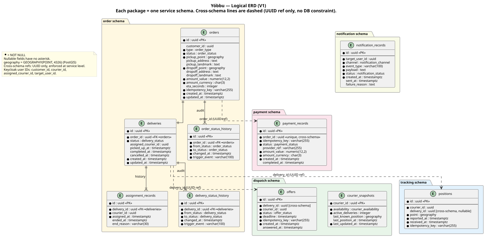

# Data model — logical, physical, and audit trail

Covers cases 1, 2 and 4 of the design checklist:
- Conceptual and logical model (entities, relationships, integrity rules)
- Physical model (PostgreSQL types, constraints, indexes, DDL)
- Audit trail (status history tables, assignment records)

**Status:** validated by the owner on 2026-11-03.

Sources: [class diagram](class-diagram.md), [state diagrams](state-diagrams.md),
[ERD](erd-logical.md), [ADR 0002](../adr/0002-architecture-microservices.md),
[ADR 0003](../adr/0003-dispatch-courier-snapshot.md).

---

## 1. Logical model

Each service owns exactly one PostgreSQL schema. No foreign key constraints cross schema
boundaries: cross-schema references use UUID columns with service-level validation only.

### Schemas and their tables

| Schema | Tables |
|--------|--------|
| `order` | `orders`, `deliveries`, `assignment_records`, `order_status_history`, `delivery_status_history` |
| `dispatch` | `offers`, `courier_snapshots` |
| `tracking` | `positions` |
| `payment` | `payment_records` |
| `notification` | `notification_records` |

### Logical diagram

 — source: [erd-logical.puml](erd-logical.puml)

### Integrity rules

**order schema**

- One `Order` produces exactly one `Delivery` (created when Order → READY).
- `deliveries.order_id` is `UNIQUE`: the 1:1 invariant is enforced in the DB.
- `assignment_records` is append-only; each row records one courier assignment attempt.
- `order_status_history` and `delivery_status_history` are append-only; written by a domain event
  handler on each state transition.

**dispatch schema**

- At most one `PENDING` offer per `delivery_id` at any time (partial unique index).
- `courier_snapshots` has at most one row per `courier_id`; the row is upserted on every
  `CourierPositionSampled` event from the tracking service (ADR 0003).

**tracking schema**

- `positions` is append-only. The `idempotency_key` prevents duplicates from batch replay.

**payment schema**

- `payment_records.order_id` is `UNIQUE`: only one payment attempt per order.
- `idempotency_key` is `UNIQUE`: duplicate provider callbacks are silently ignored.

**Cross-schema**

- `offers.delivery_id` → `deliveries.id` (UUID ref; no FK constraint)
- `positions.delivery_id` → `deliveries.id` (nullable UUID ref)
- `payment_records.order_id` → `orders.id` (UUID ref; uniqueness enforced locally)

### Domain enumerations

| Name | Values |
|------|--------|
| `order_status` | `PLACED`, `CONFIRMED`, `READY`, `DISPATCHING`, `IN_PROGRESS`, `COMPLETED`, `CANCELLED` |
| `delivery_status` | `PENDING`, `ASSIGNED`, `PICKED_UP`, `DELIVERED`, `CANCELLED` |
| `offer_status` | `PENDING`, `ACCEPTED`, `REFUSED`, `EXPIRED`, `CANCELLED` |
| `courier_availability` | `AVAILABLE`, `UNAVAILABLE` |
| `payment_status` | `PENDING`, `PAID`, `CANCELLED` |
| `notification_channel` | `PUSH`, `SMS`, `EMAIL` |
| `notification_status` | `PENDING`, `SENT`, `FAILED` |
| `order_type` | `MEAL`, `PARCEL` |

Enumerations are stored as `VARCHAR(30) NOT NULL CHECK (col IN (...))` rather than PostgreSQL
`ENUM` types to allow adding values via a non-destructive `ALTER TABLE ALTER COLUMN` instead of
`ALTER TYPE` (which requires a full-table rewrite in older PostgreSQL versions).

---

## 2. Physical model

Each service runs Flyway migrations against its own schema. The DDL below is the target for
the first migration (`V1__initial_schema.sql`) in each service.

PostGIS is enabled per database: `CREATE EXTENSION IF NOT EXISTS postgis;`

---

### order service — schema `order`

```sql
-- order service: V1__initial_schema.sql

SET search_path TO "order";

CREATE TABLE orders (
    id              UUID        PRIMARY KEY DEFAULT gen_random_uuid(),
    customer_id     UUID        NOT NULL,
    type            VARCHAR(10) NOT NULL CHECK (type IN ('MEAL', 'PARCEL')),
    status          VARCHAR(20) NOT NULL CHECK (status IN (
                        'PLACED','CONFIRMED','READY','DISPATCHING',
                        'IN_PROGRESS','COMPLETED','CANCELLED')),
    pickup_point    GEOGRAPHY(POINT, 4326) NOT NULL,
    pickup_address  TEXT,
    pickup_landmark TEXT,
    dropoff_point   GEOGRAPHY(POINT, 4326) NOT NULL,
    dropoff_address TEXT,
    dropoff_landmark TEXT,
    amount_value    NUMERIC(12, 2) NOT NULL,
    amount_currency CHAR(3)        NOT NULL DEFAULT 'XOF',
    eta_seconds     INTEGER,
    idempotency_key VARCHAR(255)   NOT NULL,
    created_at      TIMESTAMPTZ    NOT NULL DEFAULT NOW(),
    updated_at      TIMESTAMPTZ    NOT NULL DEFAULT NOW(),
    CONSTRAINT orders_idempotency_key_uq UNIQUE (idempotency_key)
);

CREATE INDEX ON orders (customer_id);
CREATE INDEX ON orders (status);
CREATE INDEX ON orders (created_at);

-- ----------------------------------------------------------------

CREATE TABLE deliveries (
    id                  UUID        PRIMARY KEY DEFAULT gen_random_uuid(),
    order_id            UUID        NOT NULL,
    status              VARCHAR(20) NOT NULL CHECK (status IN (
                            'PENDING','ASSIGNED','PICKED_UP','DELIVERED','CANCELLED')),
    assigned_courier_id UUID,
    picked_up_at        TIMESTAMPTZ,
    completed_at        TIMESTAMPTZ,
    cancelled_at        TIMESTAMPTZ,
    created_at          TIMESTAMPTZ NOT NULL DEFAULT NOW(),
    updated_at          TIMESTAMPTZ NOT NULL DEFAULT NOW(),
    CONSTRAINT deliveries_order_id_uq UNIQUE (order_id),
    CONSTRAINT deliveries_order_fk   FOREIGN KEY (order_id) REFERENCES orders (id)
);

CREATE INDEX ON deliveries (status);
CREATE INDEX ON deliveries (assigned_courier_id) WHERE assigned_courier_id IS NOT NULL;

-- ----------------------------------------------------------------

CREATE TABLE assignment_records (
    id           UUID        PRIMARY KEY DEFAULT gen_random_uuid(),
    delivery_id  UUID        NOT NULL,
    courier_id   UUID        NOT NULL,
    assigned_at  TIMESTAMPTZ NOT NULL DEFAULT NOW(),
    ended_at     TIMESTAMPTZ,
    end_reason   VARCHAR(30) CHECK (end_reason IN ('DELIVERED','CANCELLED','REASSIGNED')),
    CONSTRAINT assignment_records_delivery_fk FOREIGN KEY (delivery_id)
        REFERENCES deliveries (id)
);

CREATE INDEX ON assignment_records (delivery_id);
CREATE INDEX ON assignment_records (courier_id);

-- ----------------------------------------------------------------

CREATE TABLE order_status_history (
    id            UUID        PRIMARY KEY DEFAULT gen_random_uuid(),
    order_id      UUID        NOT NULL,
    from_status   VARCHAR(20) NOT NULL,
    to_status     VARCHAR(20) NOT NULL,
    changed_at    TIMESTAMPTZ NOT NULL DEFAULT NOW(),
    trigger_event VARCHAR(100) NOT NULL,
    CONSTRAINT order_status_history_order_fk FOREIGN KEY (order_id)
        REFERENCES orders (id)
);

CREATE INDEX ON order_status_history (order_id, changed_at DESC);

-- ----------------------------------------------------------------

CREATE TABLE delivery_status_history (
    id            UUID        PRIMARY KEY DEFAULT gen_random_uuid(),
    delivery_id   UUID        NOT NULL,
    from_status   VARCHAR(20) NOT NULL,
    to_status     VARCHAR(20) NOT NULL,
    changed_at    TIMESTAMPTZ NOT NULL DEFAULT NOW(),
    trigger_event VARCHAR(100) NOT NULL,
    CONSTRAINT delivery_status_history_delivery_fk FOREIGN KEY (delivery_id)
        REFERENCES deliveries (id)
);

CREATE INDEX ON delivery_status_history (delivery_id, changed_at DESC);
```

---

### dispatch service — schema `dispatch`

```sql
-- dispatch service: V1__initial_schema.sql

SET search_path TO "dispatch";

CREATE TABLE offers (
    id              UUID        PRIMARY KEY DEFAULT gen_random_uuid(),
    delivery_id     UUID        NOT NULL,
    courier_id      UUID        NOT NULL,
    status          VARCHAR(10) NOT NULL CHECK (status IN (
                        'PENDING','ACCEPTED','REFUSED','EXPIRED','CANCELLED')),
    deadline        TIMESTAMPTZ NOT NULL,
    idempotency_key VARCHAR(255) NOT NULL,
    created_at      TIMESTAMPTZ NOT NULL DEFAULT NOW(),
    answered_at     TIMESTAMPTZ,
    CONSTRAINT offers_idempotency_key_uq UNIQUE (idempotency_key)
);

-- At most one PENDING offer per delivery (invariant)
CREATE UNIQUE INDEX offers_one_pending_per_delivery
    ON offers (delivery_id)
    WHERE status = 'PENDING';

CREATE INDEX ON offers (courier_id, status);
CREATE INDEX ON offers (deadline) WHERE status = 'PENDING';

-- ----------------------------------------------------------------

CREATE TABLE courier_snapshots (
    courier_id          UUID        PRIMARY KEY,
    availability        VARCHAR(15) NOT NULL CHECK (availability IN ('AVAILABLE','UNAVAILABLE')),
    active_deliveries   INTEGER     NOT NULL DEFAULT 0 CHECK (active_deliveries >= 0),
    last_known_position GEOGRAPHY(POINT, 4326),
    last_position_at    TIMESTAMPTZ,
    last_updated_at     TIMESTAMPTZ NOT NULL DEFAULT NOW()
);

-- Primary index for dispatch proximity query
CREATE INDEX ON courier_snapshots USING GIST (last_known_position)
    WHERE availability = 'AVAILABLE';

CREATE INDEX ON courier_snapshots (availability, active_deliveries)
    WHERE availability = 'AVAILABLE';
```

---

### tracking service — schema `tracking`

```sql
-- tracking service: V1__initial_schema.sql

SET search_path TO "tracking";

CREATE TABLE positions (
    id              UUID        PRIMARY KEY DEFAULT gen_random_uuid(),
    courier_id      UUID        NOT NULL,
    delivery_id     UUID,
    point           GEOGRAPHY(POINT, 4326) NOT NULL,
    reported_at     TIMESTAMPTZ NOT NULL,
    received_at     TIMESTAMPTZ NOT NULL DEFAULT NOW(),
    idempotency_key VARCHAR(255) NOT NULL,
    CONSTRAINT positions_idempotency_key_uq UNIQUE (idempotency_key)
);

CREATE INDEX ON positions (courier_id, reported_at DESC);
CREATE INDEX ON positions USING GIST (point);
CREATE INDEX ON positions (delivery_id, reported_at DESC)
    WHERE delivery_id IS NOT NULL;
CREATE INDEX ON positions (received_at);
```

---

### payment service — schema `payment`

```sql
-- payment service: V1__initial_schema.sql

SET search_path TO "payment";

CREATE TABLE payment_records (
    id              UUID        PRIMARY KEY DEFAULT gen_random_uuid(),
    order_id        UUID        NOT NULL,
    idempotency_key VARCHAR(255) NOT NULL,
    status          VARCHAR(20) NOT NULL CHECK (status IN ('PENDING','PAID','CANCELLED')),
    provider_ref    VARCHAR(255),
    amount_value    NUMERIC(12, 2) NOT NULL,
    amount_currency CHAR(3)        NOT NULL DEFAULT 'XOF',
    created_at      TIMESTAMPTZ    NOT NULL DEFAULT NOW(),
    completed_at    TIMESTAMPTZ,
    CONSTRAINT payment_records_order_id_uq      UNIQUE (order_id),
    CONSTRAINT payment_records_idempotency_uq   UNIQUE (idempotency_key)
);

CREATE INDEX ON payment_records (status);
CREATE INDEX ON payment_records (created_at);
```

---

### notification service — schema `notification`

```sql
-- notification service: V1__initial_schema.sql

SET search_path TO "notification";

CREATE TABLE notification_records (
    id              UUID         PRIMARY KEY DEFAULT gen_random_uuid(),
    target_user_id  UUID         NOT NULL,
    channel         VARCHAR(10)  NOT NULL CHECK (channel IN ('PUSH','SMS','EMAIL')),
    event_type      VARCHAR(100) NOT NULL,
    payload         TEXT         NOT NULL,
    status          VARCHAR(10)  NOT NULL CHECK (status IN ('PENDING','SENT','FAILED')),
    created_at      TIMESTAMPTZ  NOT NULL DEFAULT NOW(),
    sent_at         TIMESTAMPTZ,
    failure_reason  TEXT
);

CREATE INDEX ON notification_records (target_user_id, created_at DESC);
CREATE INDEX ON notification_records (status) WHERE status IN ('PENDING','FAILED');
CREATE INDEX ON notification_records (created_at);
```

---

## 3. Audit trail

The audit trail answers the question: *what happened to this delivery and when?*

### Status history tables

`order_status_history` and `delivery_status_history` record every transition.
Each row is written inside the same database transaction that performs the transition,
so the log is always consistent with the aggregate's current state.

`trigger_event` stores the name of the Kafka event (or HTTP command) that caused the
transition, providing a link back to the event log (e.g., `OrderConfirmed`, `CourierPickedUp`).

Example for a nominal delivery:

```
order_status_history for order X:
  PLACED       → CONFIRMED    trigger: MerchantConfirmed
  CONFIRMED    → READY        trigger: MerchantDeclaredReady
  READY        → DISPATCHING  trigger: DeliveryCreated
  DISPATCHING  → IN_PROGRESS  trigger: CourierPickedUp
  IN_PROGRESS  → COMPLETED    trigger: CourierDelivered

delivery_status_history for delivery Y:
  PENDING  → ASSIGNED   trigger: DeliveryAssigned
  ASSIGNED → PICKED_UP  trigger: CourierPickedUp
  PICKED_UP → DELIVERED trigger: CourierDelivered
```

### assignment_records

Records each courier who was assigned to a delivery and how the assignment ended.
In V1 there is only one successful assignment per delivery (reassignment is V2), but the table
is already designed for multiple rows so that V2 requires no migration.

`end_reason` values:
- `DELIVERED` — normal completion
- `CANCELLED` — order cancelled before pickup
- `REASSIGNED` — operator forced reassignment (V2; row is written at reassignment time)

### Courier position trail

The `positions` table in the tracking schema provides a full movement history for each courier.
It is not an audit of business state transitions, but it supports operational investigations
(e.g., "where was the courier when the delivery was reported?").

### What is NOT stored in the DB

The Kafka topic `delivery-events` retains all domain events for a configurable retention window
(72 h in V1). For full long-term event traceability, a separate archival strategy (event store
or dead-letter export) is considered out of scope for V1.

---

## 4. Decisions

Confirmed by the owner on 2026-11-03.

1. **Enumerations as CHECK constraints, not PostgreSQL ENUM types.** Adding a new value to a
   `ENUM` type requires `ALTER TYPE … ADD VALUE` which cannot run inside a transaction in
   PostgreSQL < 12 and still requires care in higher versions. A `VARCHAR CHECK (col IN (…))`
   column is altered with a plain `ALTER TABLE ALTER COLUMN … SET CHECK`, which runs online.

2. **Status history tables, not a generic event-log table.** A generic `events` table mixing
   order events, delivery events and payment events would require type discriminators everywhere
   and make queries harder. Two narrow tables (`order_status_history`,
   `delivery_status_history`) are trivially queryable and carry no ambiguity.

3. **Partial unique index for the "one PENDING offer" invariant.** A standard unique index on
   `delivery_id` alone would prevent creating a second offer after the first is closed. A
   partial index on `WHERE status = 'PENDING'` enforces the invariant without blocking the
   natural sequence of offer creation.

4. **GiST index on `courier_snapshots.last_known_position` filtered by availability.** The
   dispatch proximity query always filters `availability = 'AVAILABLE'`, so the partial GiST
   index covers only the rows that matter, keeping it small and fast.

5. **`updated_at` is application-managed, not a trigger.** A trigger is simpler to forget to
   disable during bulk migrations. The application layer sets `updated_at = NOW()` on every
   write; this is documented and enforced by the domain service, not by the DB.
