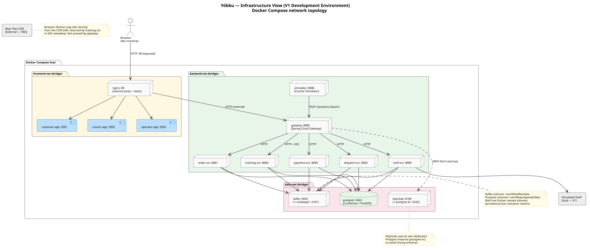

# Infrastructure view

Technical and infrastructure view: environments, networks, storage, and I/O flows for V1.

**Status:** validated by the owner on 2026-11-03.

Sources: [C4 model](c4.md), [architecture diagrams](architecture-diagrams.md),
[data model retention](data-model-retention.md),
[ADR 0001](../adr/0001-architecture-microservices.md).

---

## Network diagram

 — source:
[infrastructure-view.puml](infrastructure-view.puml)

---

## Environments

| Environment | Purpose | Status |
|-------------|---------|--------|
| **Development** | One-command local startup (`docker compose up`) | V1 — this document |
| **Staging** | Pre-production smoke tests, shared among contributors | Phase 3 |
| **Production** | Public demo; real load; zero-downtime deploys | Phase 3 |

Production environment design (orchestration, managed services, cloud provider) is deferred
to phase 3 and will be covered by a dedicated ADR. All decisions here apply to the
development environment only.

---

## Docker Compose network topology

Three isolated bridge networks contain the services. A container can only reach containers
in networks it is attached to.

| Network | Containers | Traffic |
|---------|-----------|---------|
| `frontend-net` | nginx, customer-app, courier-app, operator-app | HTTP between nginx and the three static servers |
| `backend-net` | gateway, all 5 services, courier simulator | HTTP/REST between gateway and services |
| `data-net` | postgres, kafka, zookeeper, keycloak, postgres-kc | JDBC (5432/5433), Kafka protocol (9092), Zookeeper (2181) |

Nginx sits at the boundary of `frontend-net` and `backend-net`: it serves static PWA assets
and proxies `/api` requests to the gateway. The gateway sits at the boundary of
`backend-net` and `data-net`: it routes HTTP to services, which then reach the data tier.

**No backend service is exposed directly to the developer's browser.** All HTTP goes through
nginx → gateway.

### Exposed ports (host → container)

| Host port | Container | Purpose |
|-----------|-----------|---------|
| 80 | nginx | Developer browser entry point |
| 8180 | keycloak | Keycloak admin console (dev only) |
| 5432 | postgres | Direct DB access for development (psql, DB tool) |
| 9092 | kafka | Kafka CLI tools (kafka-console-consumer, etc.) |

All other ports are internal only.

---

## Storage

| Volume | Container | Data |
|--------|-----------|------|
| `postgres-data` | postgres | All 5 service schemas + PostGIS extension |
| `postgres-kc-data` | postgres-kc | Keycloak realm, users, clients |
| `kafka-data` | kafka | Topic data and offsets |
| `zookeeper-data` | zookeeper | Kafka cluster metadata |

Volumes are Docker named volumes, persisted across container restarts. `docker compose down`
preserves them; `docker compose down -v` removes them (full reset).

The `positions` table will grow at ~173 MB/day at demo scale (100 couriers). At 30 days, the
`postgres-data` volume will hold ~5 GB of positions. The daily cleanup job described in
[data-model-retention.md](data-model-retention.md) keeps it bounded.

---

## Incoming and outgoing flows

### Inbound to the system

| Source | Destination | Protocol | Notes |
|--------|------------|----------|-------|
| Developer browser | nginx :80 | HTTP | Static assets + API proxy |
| Courier PWA (batch sync) | nginx → gateway → tracking-svc | HTTPS | Position batch on reconnect |
| Payment provider callback (simulated) | gateway → payment-svc | HTTPS | Idempotent POST |

### Outbound from the system

| Source | Destination | Protocol | Notes |
|--------|------------|----------|-------|
| gateway | Keycloak :8180 | HTTP (dev) | JWKS endpoint for token validation keys |
| notification-svc | Notification stub | HTTP | Simulated push/SMS/email in V1 |
| Browser | Map tiles CDN | HTTPS | Tiles fetched directly by the browser; URL comes from tracking-svc SSE metadata |

### Internal cross-service flows

All cross-service communication goes through Kafka (see [event catalogue](event-catalogue.md)).
There are no synchronous HTTP calls between backend services.

The one internal synchronous call is gateway → Keycloak (JWKS), which happens once at startup
and whenever the gateway detects a JWT signed by an unknown key ID (key rotation). Keycloak
must be reachable at startup, or the gateway fails to start.

---

## Decisions

Confirmed by the owner on 2026-11-03.

1. **Keycloak runs with its own dedicated Postgres instance (`postgres-kc`).** This avoids
   mixing Keycloak's internal schema with the service schemas on `postgres`. It also allows
   backing up and restoring identity data independently from application data.

2. **Nginx handles static asset serving and the frontend-to-backend proxy.** This matches the
   production pattern (a load balancer or CDN in front, a reverse proxy routing to services)
   without introducing a full Kubernetes ingress in development. `docker compose up` mirrors
   the production topology at one level of abstraction.

3. **All service ports are internal in development.** The developer accesses the entire stack
   through port 80. This forces all requests through the gateway's auth checks and avoids
   the common dev-only bypass where a developer calls a service port directly.
