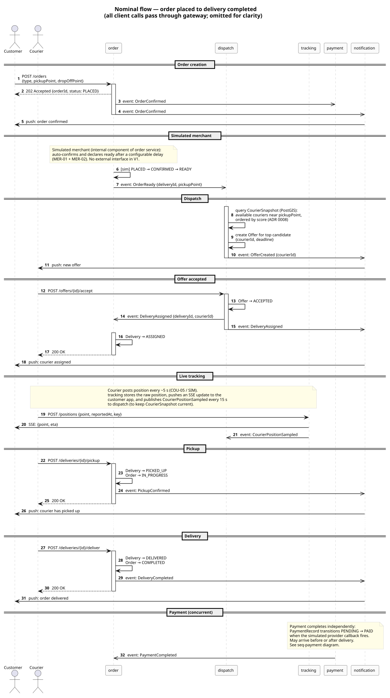
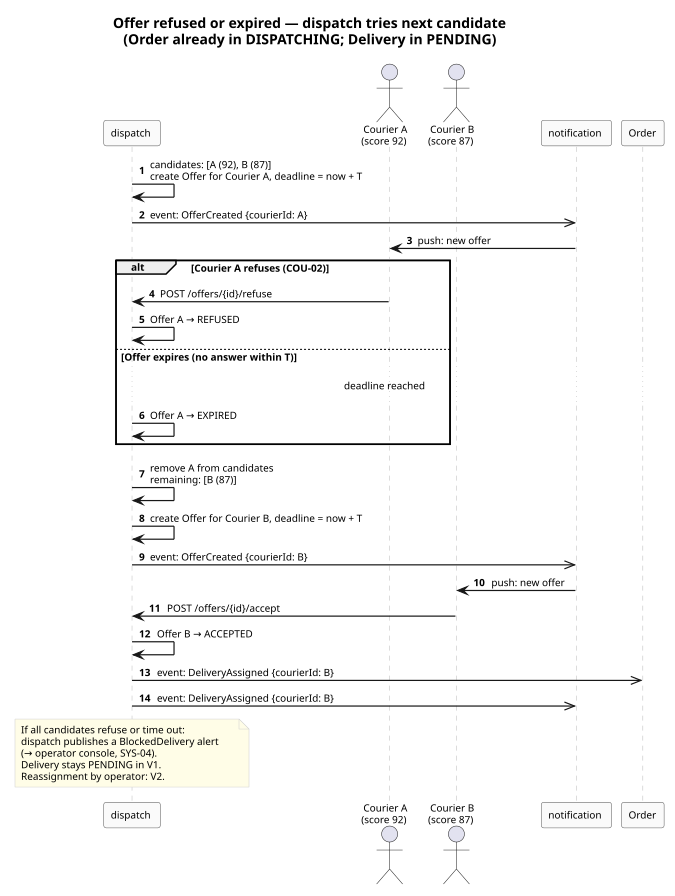
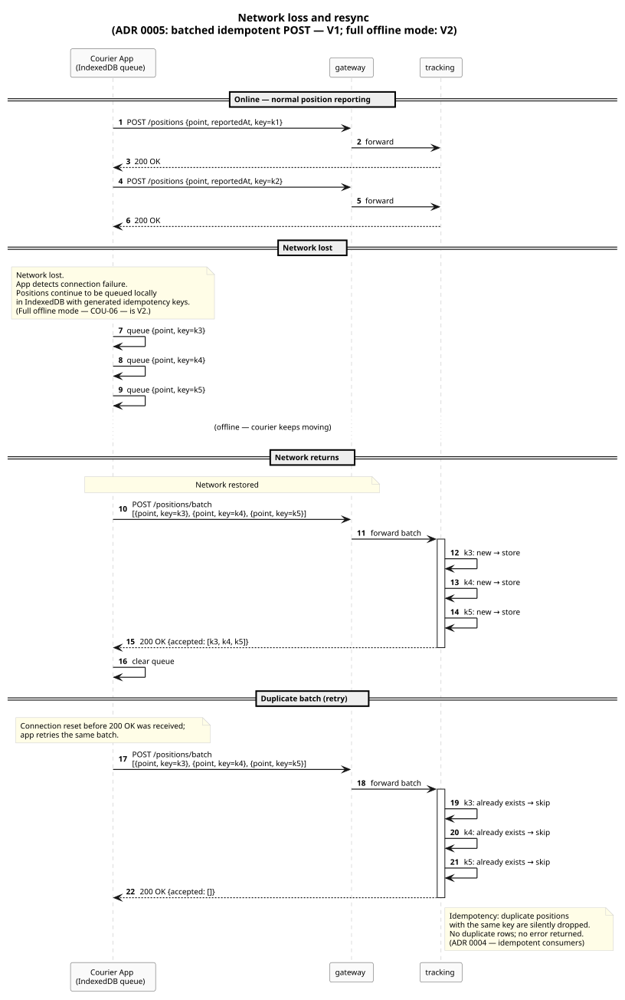
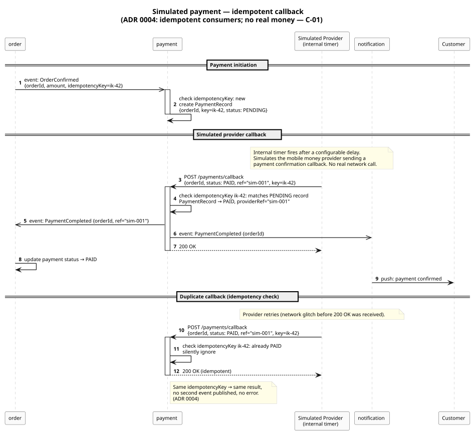
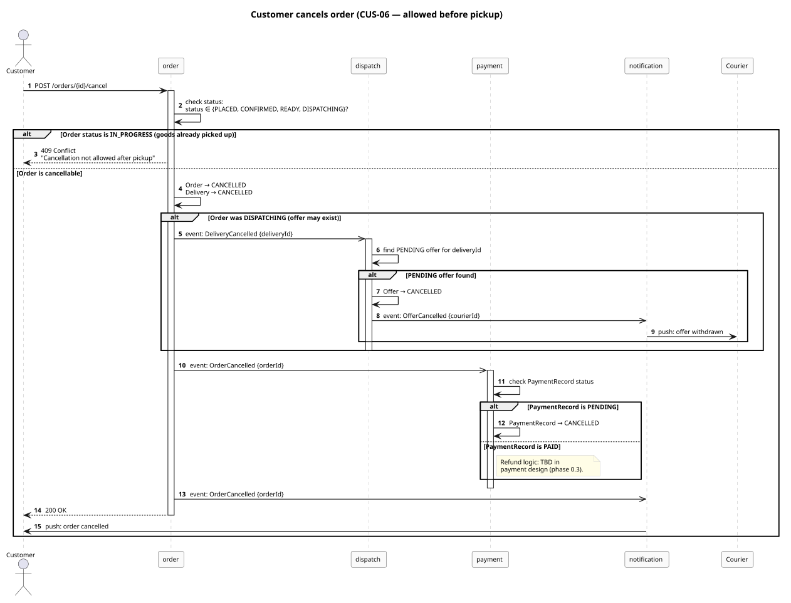

# Sequence diagrams

Five scenarios covering the key flows: the nominal path, the two failure cases for an offer
(refusal and expiry), network loss and resync, simulated payment with idempotent callback,
and order cancellation.

**Status:** validated by the owner on 2026-11-03.

All client calls are routed through `gateway`; the gateway is omitted from the diagrams for
clarity (it adds no business logic, only auth check and routing). Events sent over Kafka are
shown as `→→` (async fire-and-forget from the caller's perspective).

Sources: [state diagrams](state-diagrams.md), [domain breakdown](domain-breakdown.md),
[ADR 0004](../adr/0004-messaging-kafka.md), [ADR 0005](../adr/0005-realtime-sse.md).

---

## Nominal flow

 — source: [seq-nominal.puml](seq-nominal.puml)

The complete happy path from order creation to delivery. Key points:

- The simulated merchant is an internal component of the `order` service; it auto-confirms and
  auto-declares ready after a configurable delay (MER-01 + MER-02).
- `dispatch` reads its local `CourierSnapshot` for the proximity query; no synchronous call to
  `tracking` at assignment time (ADR 0003).
- Position reporting and SSE are shown as a single exchange; the real flow is continuous.
- Payment runs independently: `PaymentCompleted` may arrive before or after delivery.

---

## Offer refused or expired

 — source:
[seq-offer-refused.puml](seq-offer-refused.puml)

Dispatch iterates over the ranked candidate list, creating one offer at a time. Whether the
previous courier refuses or the deadline passes, the outcome is the same: the candidate is removed
and a new offer goes to the next one.

If the list is exhausted without an acceptance, dispatch publishes a `BlockedDelivery` event that
triggers an alert to the operator (SYS-04). The delivery stays `PENDING` in V1.

---

## Network loss and resync

 — source:
[seq-network-loss.puml](seq-network-loss.puml)

The courier app queues position reports locally (IndexedDB) when the network is unavailable.
On reconnect it sends a batch `POST /positions/batch` carrying all queued entries with their
idempotency keys. The `tracking` service stores new entries and silently drops duplicates.

This covers V1 (position queue only). Full offline mode (COU-06: state changes, offer answers,
delivery updates while offline) is V2 and uses the same idempotency mechanism extended to all
action types.

---

## Simulated payment with idempotent callback

 — source: [seq-payment.puml](seq-payment.puml)

The `payment` service receives `OrderConfirmed` and creates a `PaymentRecord` (PENDING). An
internal timer fires a fake provider callback. The callback is handled idempotently: if the same
`idempotencyKey` arrives again (retry or provider duplicate), the service returns 200 OK without
publishing a second `PaymentCompleted` event.

No real money, no real network call (C-01).

---

## Cancellation

 — source:
[seq-cancellation.puml](seq-cancellation.puml)

A cancel request is rejected once the courier has picked up the goods (status `IN_PROGRESS`).
Before that:

- If the order was `DISPATCHING`, a `DeliveryCancelled` event tells `dispatch` to revoke any
  pending offer and notify the courier.
- `payment` receives `OrderCancelled` and cancels a `PENDING` payment record; a `PAID` record
  triggers a refund path to be defined in the payment design (phase 0.3).
- A notification goes to the customer.

---

## Decisions

Confirmed by the owner on 2026-11-03.

1. **Gateway is omitted from the diagrams.** It is a thin proxy; including it in every diagram
   would add noise without information. Its role is documented in the component diagram.
2. **Kafka events are fire-and-forget from the publisher's perspective.** The arrows in the diagrams
   reflect this: the publisher does not wait for consumers to process the event before continuing.
3. **Payment can complete before or after delivery.** No ordering constraint exists between the
   payment flow and the delivery flow in V1. The `order` service handles both outcomes
   independently.
4. **Refund logic for a cancelled-after-payment order is deferred** to the payment design later
   in phase 0.3 (data model, state classification).
