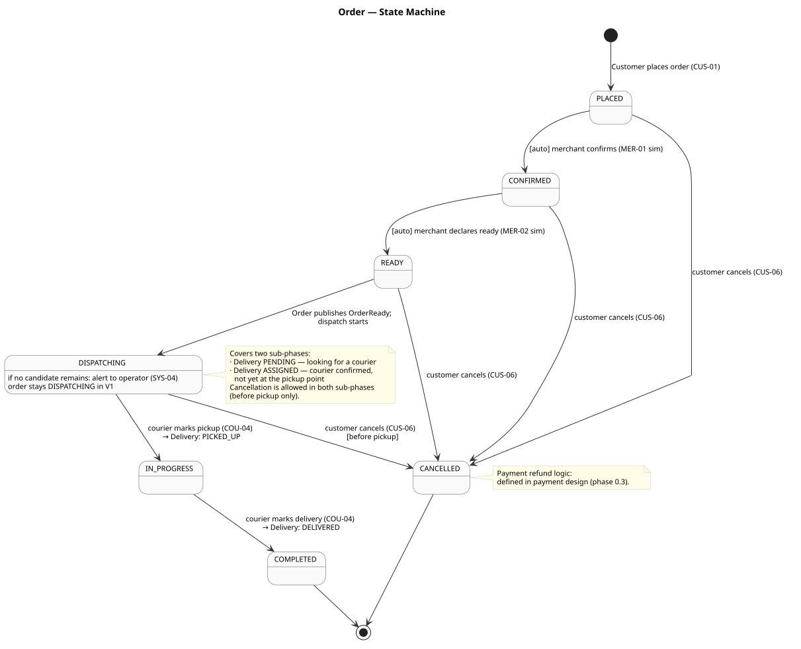
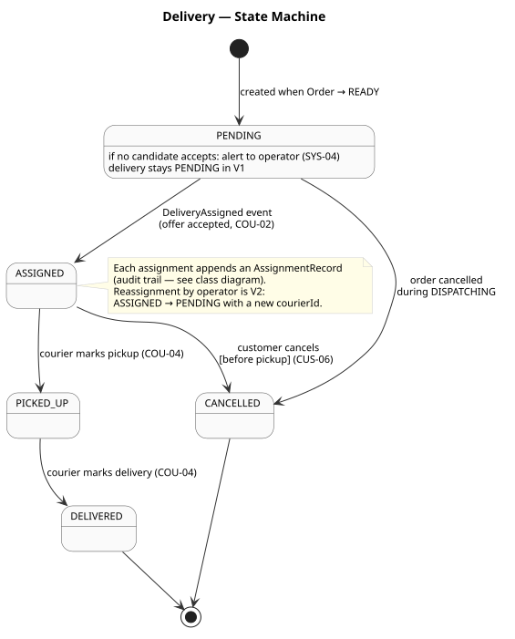
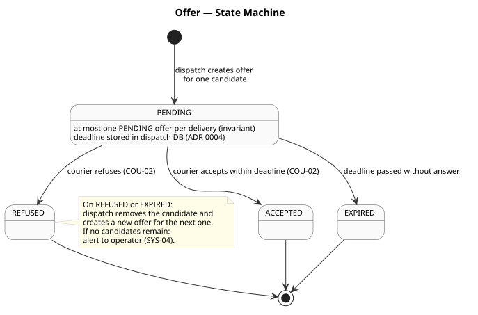
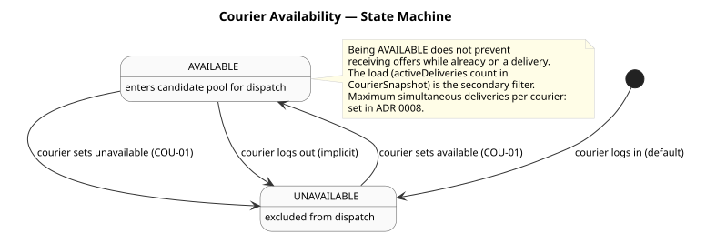

# State diagrams

Four state machines that drive the core domain behaviour. Each one shows the allowed transitions,
the events or actions that trigger them, and the invariants that prevent invalid ones.

**Status:** validated by the owner on 2026-11-03.

Sources: [class diagram](class-diagram.md), [glossary](glossary.md),
[use cases](use-cases.md), [ADR 0004](../adr/0004-messaging-kafka.md),
[ADR 0005](../adr/0005-realtime-sse.md).

---

## Order

 — source: [state-order.puml](state-order.puml)

The `Order` aggregate owns the commercial lifecycle. The simulated merchant drives the first two
transitions automatically (configurable delay). The transition to `IN_PROGRESS` is triggered when
the courier marks pickup; `COMPLETED` when the courier confirms delivery.

`DISPATCHING` covers two sub-phases without a separate status: the period when dispatch is looking
for a courier (Delivery `PENDING`) and the period when a courier is confirmed but has not yet
picked up the goods (Delivery `ASSIGNED`). Cancellation remains allowed in both sub-phases.

If no candidate accepts all offers, the order stays `DISPATCHING` and an alert goes to the operator
(`SYS-04`). No automatic timeout or cancellation occurs in V1.

---

## Delivery

 — source: [state-delivery.puml](state-delivery.puml)

The `Delivery` aggregate owns the transport job. It is created when the `Order` transitions to
`READY`, starts in `PENDING`, and moves forward as couriers act on it.

Each time a courier is assigned, an `AssignmentRecord` is appended (audit trail). In V1 there is
only one assignment per delivery (no reassignment by the operator; that is V2). Cancellation is
allowed until `PICKED_UP`.

The relationship between `Order` and `Delivery` state machines:

| Delivery state | Triggers in Order |
|---|---|
| `PICKED_UP` | Order → `IN_PROGRESS` |
| `DELIVERED` | Order → `COMPLETED` |
| `CANCELLED` | Order → `CANCELLED` |

---

## Offer

 — source: [state-offer.puml](state-offer.puml)

The `Offer` aggregate is short-lived: created by dispatch for one candidate, answered within the
deadline, then terminal. At most one `PENDING` offer exists per delivery at any moment (invariant
in the dispatch service).

On `REFUSED` or `EXPIRED`, dispatch creates a new offer for the next candidate. When no candidates
remain, a `BlockedDelivery` alert is published for the operator.

---

## Courier availability

 — source:
[state-courier-availability.puml](state-courier-availability.puml)

Two states toggled explicitly by the courier (or implicitly on logout). Being `AVAILABLE` is
necessary but not sufficient to receive an offer: `dispatch` also checks the courier's load
(`activeDeliveries` count in `CourierSnapshot`). The maximum simultaneous deliveries per courier
is a parameter of the dispatch algorithm (ADR 0008).

---

## Decisions

Confirmed by the owner on 2026-11-03.

1. **`DISPATCHING` is not split into sub-statuses.** The sub-phases (looking / assigned-not-picked-up)
   are visible in the `Delivery` state machine, not in `Order`. This avoids an extra status that
   would add a transition without adding useful information for the customer.
2. **No automatic order timeout in DISPATCHING (V1).** If no courier accepts, the order stays in
   `DISPATCHING` and an operator alert fires. Automatic fallback (widen radius, reassign) is V2.
3. **Refund on cancellation after payment is deferred.** The refund or cancellation of a
   `PAID` payment record is defined in the payment design later in phase 0.3.
