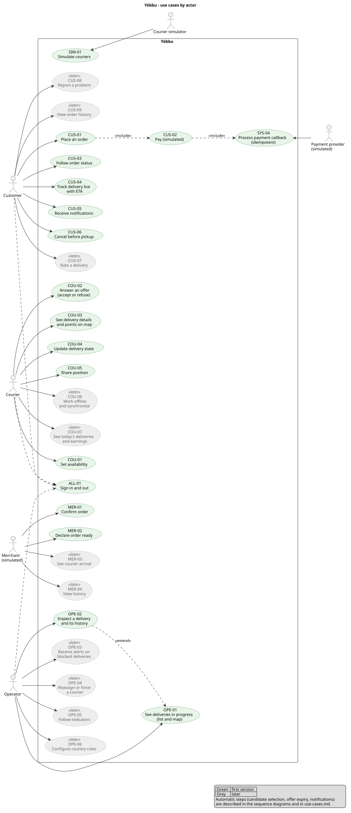

# Use cases

Use cases by actor, with their phase. Vocabulary follows the [glossary](glossary.md). Source of the functional scope: `docs/PROJECT.md` (sections 3 and 5) and the scoping decisions of phase 0.1.

**Status:** draft, to be confirmed by the owner. Points that need a decision are listed in [Open points](#open-points).

Source: [use-cases.puml](use-cases.puml). Regenerate with `scripts/diagrams.sh` (ADR 0009).

**Phase:** `V1` = first version; `Later` = planned after the first version (phase 2 or later, see `PLAN.md`).

## Common

| ID | Use case | Actor | Phase | Summary |
| --- | --- | --- | --- | --- |
| ALL-01 | Sign in and out | Customer, Courier, Operator | V1 | Authenticate with username and password against the identity provider (ADR 0007). Rights depend on the role. Fictitious accounts only. |

## Customer

| ID | Use case | Phase | Summary and notable variants |
| --- | --- | --- | --- |
| CUS-01 | Place an order | V1 | Choose the type (meal or parcel), give the pickup and drop-off points (map point, optional landmark), see the simulated amount, confirm. Includes CUS-02. Variant: invalid or missing location, order refused with an explanation. |
| CUS-02 | Pay (simulated) | V1 | Start a simulated mobile money payment. The result arrives later through SYS-04, so the order may wait in a pending-payment state. Variants: payment failed, payment confirmed twice (ignored). |
| CUS-03 | Follow order status | V1 | See the current state of the order and its delivery. |
| CUS-04 | Track delivery live with ETA | V1 | See the courier move on a map with an estimated arrival time (straight-line estimate, declared simplification). Variant: network loss, the view resumes with a snapshot then the live stream (ADR 0005). |
| CUS-05 | Receive notifications | V1 | Be notified at each key step. In-app only in the first version; SMS and email simulated. |
| CUS-06 | Cancel before pickup | V1 | Cancel the order until the courier has picked up the goods. Variant: too late, cancellation refused. See [open points](#open-points). |
| CUS-07 | Rate a delivery | Later | Rate a completed delivery. |
| CUS-08 | Report a problem | Later | Report an issue about a delivery. |
| CUS-09 | View order history | Later | List past orders. |

## Courier

| ID | Use case | Phase | Summary and notable variants |
| --- | --- | --- | --- |
| COU-01 | Set availability | V1 | Switch between available and unavailable. Only available couriers become candidates. |
| COU-02 | Answer an offer | V1 | Receive an offer, accept or refuse it before the deadline. Variants: refusal (next candidate), expiry (next candidate), offer already taken or withdrawn. |
| COU-03 | See delivery details and points on map | V1 | See pickup point, drop-off point, landmarks and useful information. Route guidance is not provided in the first version (no routing engine, ADR 0003). |
| COU-04 | Update delivery state | V1 | Mark the goods picked up, then handed over, in one gesture each. Invalid transitions are refused. |
| COU-05 | Share position | V1 | The courier app sends positions while available or on a delivery (ADR 0005). |
| COU-06 | Work offline and synchronise | Later | Keep working during a network loss and replay queued actions without loss or duplicates. |
| COU-07 | See today's deliveries and earnings | Later | List the day's deliveries and amounts. |

## Merchant (simulated in the first version)

In the first version the merchant has no interface: MER-01 and MER-02 are simulated, so the whole journey can be demonstrated.

| ID | Use case | Phase | Summary |
| --- | --- | --- | --- |
| MER-01 | Confirm order | V1 (simulated) | The merchant accepts the order. Variant: rejection or no answer, to be covered by the order state diagram. |
| MER-02 | Declare order ready | V1 (simulated) | The goods can be collected. This triggers the dispatch. |
| MER-03 | See courier arrival | Later | Real merchant space: see that the courier is coming. |
| MER-04 | View history | Later | Real merchant space: list past orders. |

## Operator

| ID | Use case | Phase | Summary and notable variants |
| --- | --- | --- | --- |
| OPE-01 | See deliveries in progress | V1 | List and map of the deliveries in progress (minimal console). |
| OPE-02 | Inspect a delivery and its history | V1 | Open a delivery and read its state history (read-only in the first version). Extends OPE-01. |
| OPE-03 | Receive alerts on blocked deliveries | Later | Be alerted when no courier is found, a courier is unreachable or the customer is absent. |
| OPE-04 | Reassign or force a courier | Later | Replace the courier of a delivery or choose one by hand. |
| OPE-05 | Follow indicators | Later | Average delay, acceptance rate, delays. |
| OPE-06 | Configure country rules | Later | Adapt zones, hours and rules per country. |

## System and external actors

These steps run without a user action. They are shown in the diagram only when an external actor triggers them; the rest is described in the sequence diagrams.

| ID | Use case | Trigger | Phase | Summary |
| --- | --- | --- | --- | --- |
| SYS-01 | Select candidates and rank them | Order declared ready | V1 | Find available couriers near the pickup point and compute their score (ADR 0003, ADR 0008). |
| SYS-02 | Offer to a courier and handle expiry or refusal | Candidate chosen | V1 | Send the offer with a deadline; on refusal or expiry, go to the next candidate. The deadline is stored in the dispatch database (ADR 0004). |
| SYS-03 | Handle "no courier found" | No candidate accepts | V1 (minimal) | The delivery stays pending and visible in the operator console (OPE-01). Alerts and fallback rules come later (OPE-03, ADR 0008). |
| SYS-04 | Process payment callback | Callback from the simulated payment provider | V1 | Update the payment status; duplicate callbacks have no extra effect. External actor: payment provider (simulated). |
| SYS-05 | Send notifications | State change | V1 | Produce the notifications of CUS-05. |
| SIM-01 | Simulate couriers | Demo or load test | V1 | A simulator drives virtual couriers that move on the map, set availability and answer offers. External actor: courier simulator. |

## Open points

Proposed answers are in italics.

1. **Cancellation (CUS-06) is in the first version.** The product description lists it for the customer, and a sequence diagram for cancellation is planned in phase 0.3. *If it makes the first version too large, it moves to phase 2.*
2. **How the merchant is simulated (MER-01, MER-02).** Either automatically after a configurable delay, or through a button in the operator console. *To be decided with the order service design; the first option keeps the console minimal.*
3. **"No courier found" in the first version (SYS-03).** *The delivery stays pending and appears in the operator console; no automatic alert until OPE-03.* The fallback rules (widening the search, retries) are part of ADR 0008.
4. **Courier route guidance (COU-03).** *Only points on a map in the first version*, since a routing engine is not planned (ADR 0003).
5. **Order history for the customer (CUS-09)** is not placed in any phase of `PLAN.md` yet, although it is in the customer feature list of `docs/PROJECT.md`. *Marked "Later"; to be added to a phase when the plan is next revised.* Rating (CUS-07) and reporting (CUS-08) are in phase 2 of the plan.
